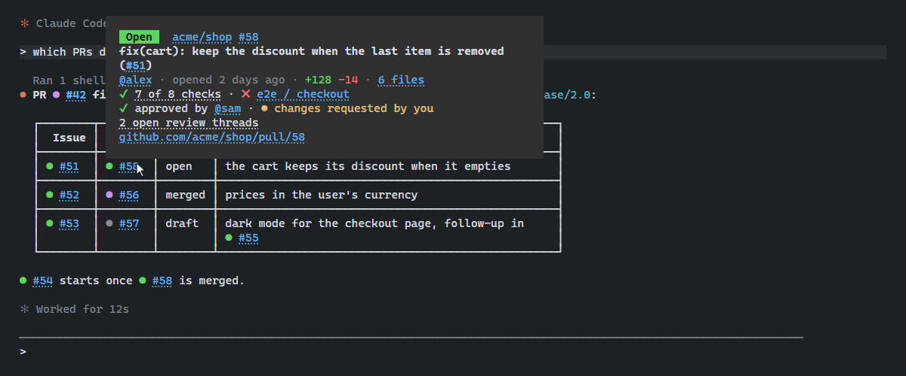

# pullywog

A Claude Code mod and a [Pi](https://pi.dev) extension that turns GitHub pull request and issue references in the agent's replies into live links.



- `#1234`, `owner/repo#1234`, GitHub URLs and the numbers in a table column headed `#`, `PR` or `Issue` get a dot in the state's color: green open, gray draft, purple merged, red closed.
- Hovering a reference opens a card: state, title, author, age, size, checks, reviews and open threads.
- Every reference in the card is a link: repo, title references, author, reviewers, files, checks and the failing check's run. Ctrl+click opens it.
- A plain click on a reference tracks it in a band above the prompt. Each chip shows the state dot, number, title, author, age and checks, three to a row, in groups: needs you (your review is asked for, or your PR fails its checks or got changes requested), waiting, done. A ▎ marks the selected chip. Sessions in the same GitHub repo, worktrees included, share one tracked list.
- A click on a key under the chips runs it. For the keyboard, press the band focus key (Ctrl+X, then Tab, unless `abovePrompt:focus` is rebound in `~/.claude/keybindings.json`): ↑ ↓ (or Tab) move between chips, Esc goes back to the prompt, and one key acts on the focused chip: `a` approve (press twice), `r` request changes (opens the PR), `f` re-run the failed checks, `o` open, `c` copy the link as rich text for a chat such as Teams (plain text where rich text cannot go), `x` remove.

The details come from one `gh api graphql` call per repo, cached for 60 seconds.

## Requirements

- Claude Code 2.1.327 or later, the version the mod is tested on.
- The GitHub CLI, `gh`, signed in to an account that can read the repos.
- Fullscreen rendering for the hover card: run `/tui fullscreen` once, or start Claude Code with `CLAUDE_CODE_NO_FLICKER=1`. Without it the dots and links show, and cards do not open.

## Install

```sh
claude plugin marketplace add accodev/pr-cards
claude plugin install pullywog@pullywog
```

Then run `/reload-plugins` in a running session, or start a new one. Remove it with `claude plugin uninstall pullywog@pullywog`.

Before 0.8.0 the plugin was named pr-cards. To move over, remove the old one and its marketplace, then install as above:

```sh
claude plugin uninstall pr-cards@pr-cards
claude plugin marketplace remove pr-cards
```

The tracked lists live in the plugin's own store file under `~/.claude/plugins/store/`. To keep them, copy `pr-cards_pr-cards-*.json` over the new `pullywog_pullywog-*.json` once pullywog has run.

## Pi

```sh
pi install git:github.com/accodev/pullywog
```

Run `/reload` in an open session to load it. In Pi's fullscreen mode (`tuiMode`, the default) the extension works as the Claude Code mod:

- References in replies get the state dot. Hovering one opens its card (`cardStyle` picks `card` or `github`), a plain click tracks it, and Ctrl+click opens it on GitHub. A click on a link in the card opens it.
- Pi gives extensions no mouse hook in its transcript, so pullywog reads the mouse reports from the terminal input beside Pi, as `@narumitw/pi-inline` does. Pi's regular mode, tmux, Zellij and Screen send none: there the dots show, and `/track` stands in for the click.
- `/track #1234` (or `owner/repo#1234`, or a GitHub URL) puts a PR in the band; with no argument it offers the references of this session's replies. `/untrack` takes it out.
- `Alt+A` moves to the band: arrows pick a chip, the same keys act on it (`a` approve, press twice; `r` request changes; `f` re-run failed checks; `o` open; `c` copy the link; `x` remove), Esc goes back. In Pi's fullscreen mode (`tuiMode`, the default) a click on the bar folds the band, and a click on a chip selects it.

The band, its groups and its chips match the Claude Code mod. Pi has no orange theme key: the bar takes the theme's accent color. The Pi extension keeps the tracked lists in `~/.pi/agent/pullywog.json`, apart from Claude Code's. Pi's `settings.json` takes `cardStyle`, `trackedBand`, `bandPerRow` and `shareTracked` (below) under a `pullywog` key, for example `"pullywog": { "bandPerRow": 2 }`.

## Settings

`cardStyle` picks the hover card: `card` (the default) or `github`.

- `card` draws the full card: state, title, author, size, checks, reviews and threads.
- `github` draws GitHub's own hover card layout: repo and date, state with title and number, branches, then the review and checks.

`trackedBand` (default `true`) turns the band above the prompt on or off. `bandPerRow` (default `3`, up to `6`) sets how many tracked PRs share a row of a group. `shareTracked` (default `true`) gives the sessions of one GitHub repo, or of one folder outside git, one tracked list; off, each session keeps its own.

Set them in `/plugin`, or from the shell:

```sh
echo '{"cardStyle": "github"}' | claude plugin configure pullywog@pullywog --values-stdin
```

## Develop

```sh
claude --plugin-dir .            # run Claude Code with this checkout
claude plugin validate .
claude plugin test .
uv run --no-project --with pywinpty --with pyte python -I scripts/e2e.py C:/code/market-it
npm ci
npm run typecheck:pi
npm run test:pi
uv run --no-project --with pywinpty --with pyte python -I scripts/pi-e2e.py C:/code/market-it
```

`scripts/e2e.py` drives a real fullscreen session in a pseudo-terminal, hovers and clicks references, and checks the screen. `scripts/pi-e2e.py` does the same for Pi: it tracks a PR, moves to the band, checks the dots in a reply, and removes the PR. The design notes are in `docs/handover.md`, the repo rules in `AGENTS.md`.
